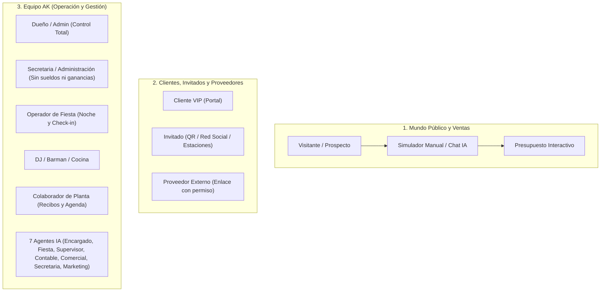

# Auditoría Integral y Plan Maestro — AK Producciones (Rumbo a la Mejor App de Eventos del Mundo)

> [!IMPORTANT]
> **Criterio de esta auditoría:** Todo lo que figura acá fue verificado contra el código real de hoy (`origin/main`), cruzando las evidencias de **Codex (tandas 131, 132 y 133)**, las revisiones de **Claude (`YA-RESUELTO.md` y `LO-QUE-NO-VI.md`)**, las órdenes activas (**176 y 177**) y nuestras skills de **Neuroventas, Diseño Web, UX Móvil, SEO y Arquitectura AK**.

---

## 1. Contraste con Codex y Claude: Qué ya está 10 puntos (y NO se toca)

Antes de meter mano, separamos el trigo de la paja para no romper lo que ya anda ni repetir falsas alarmas:

| Área / Módulo | Estado Real | Verificación |
| :--- | :--- | :--- |
| **Estaciones en vivo** (Fotocabina 3 fotos, Espejo Mágico IA, QR Recuerdo, Trivia y Ranking) | **Aprobado (PASS)** | No congela tablets si falla la red; la fotocabina imprime postal 10x15 sola; si la IA demora, guarda la foto original para aprobar después. |
| **Muro Social, Red Social del Invitado y Chat en Vivo** | **Aprobado (PASS)** | 4/4 en celular y compu. Si se corta internet no borra los mensajes ni miente diciendo "0 mensajes": avisa que está reconectando. |
| **Panel de DJ y Pantalla de Tragos Listos (Órdenes 169 y 170)** | **Aprobado (PASS)** | El DJ ya ve la lista *"Si es posible"* del cliente y puede desmarcar temas. La barra avisa si pierde conexión sin mostrar estados falsos. |
| **Cobros rápidos, Plan de cuotas, Flujo de caja y Hoja de cocina** | **Aprobado (PASS)** | 7/7 recorridos aprobados en auditoría 133. Los cobros entre varios dispositivos no se pisan. |
| **Cifras y Reglas del Dueño** | **Inmutables** | **+200 eventos**, **+7 años**, **Clientes satisfechos** (sin porcentajes inventados), ajuste anual del 15%, descuento 50% en Club Uruguay y **prohibido usar la palabra "congelar"**. |
| **Falsas alarmas descartadas** | **Cerradas** | Los avisos de credenciales falsas de Firebase en el banco de pruebas (Orden 174) y las demoras de cierre de pantalla 3D en el robot de pruebas son límites del entorno de testeo, no fallas de tu app. |

---

## 2. Auditoría de Roles y Funciones: Quién hace qué y dónde estaban los agujeros

Revisamos punta a punta los **11 roles** que conviven en la app:

### Errores reales y desconexiones detectadas en Roles y Portal VIP:

1. **Botón "Documentos" del Portal Cliente llevaba al Menú de Comida (`src/app/portal/page.tsx`):**
   - Cuando el cliente entraba a su portal y tocaba **"Documentos"** (para ver su contrato y recibos), el enlace estaba mal conectado a `/portal-cliente/[id]/menu` en vez de llevarlo a su contrato (`/portal/[id]/contrato`).
2. **Botón "Lista de Regalos" del Portal Cliente lo mandaba al panel privado del equipo (`src/app/portal/page.tsx`):**
   - El enlace apuntaba a `/fiestas/nueva/regalos?fiestaId=...` (pantalla interna de administración). Cuando el cliente lo tocaba sin sesión de empleado, el sistema lo rebotaba a la pantalla de login de personal.
3. **Atajos del Portal (`/portal/[fiestaId]/musica`, `/tareas`, `/video-vida`, `/fotografia`) rebotaban al login (`src/app/portal/[fiestaId]/[module]/page.tsx`):**
   - Redirigían a `/fiestas/nueva/...` en vez de llevar al cliente a las pantallas propias de su portal (`/portal-cliente/[id]/musica`, `/portal/[id]/video-vida`, etc.).
4. **Nombre del firmante en el Contrato Digital (`src/app/portal/[fiestaId]/contrato/page.tsx`):**
   - Si el cliente no tenía cargado `clienteNombre`, el código intentaba adivinarlo cortando el nombre del evento por la palabra `" de "` (`nombreEvento.split(' de ')[1]`). En *"Cumpleaños de 15 de Sofía"* ponía **"15"** como nombre de la persona que firmaba, y en *"Boda Juan y Ana"* ponía **"Cliente"**.
5. **Pantalla de Mesas del Portal abierta sin llave (`src/app/portal/mesas/page.tsx`):**
   - Al estar bajo `/portal`, no verificaba si el cliente había puesto la clave de su fiesta (`portal_auth_[fiestaId]`) ni si había sesión del equipo. Cualquiera con el link podía mover invitados de mesa.
6. **Fuga de datos financieros en el Chat Multiagente (`src/app/actions/multiagent.ts` y `src/app/api/multiagent/message/route.ts`):**
   - Aunque el sistema bloquea muy bien las pantallas de sueldos y ganancias para el perfil `operador` o `personal`, el asistente de IA interno inyectaba el resumen financiero completo sin chequear `puede(usuario, PERMISOS.CONTABILIDAD)`. Si un operador le preguntaba al bot cuánto se facturó o ganó en el mes, el bot podía contestarle.
7. **Doble sistema de permisos en `/admin/usuarios`:**
   - Conviven los perfiles claros (`dueno`, `secretaria`, `operador`, `personal`) con casillas sueltas viejas. Conviene priorizar siempre el perfil claro para no confundir al dar de alta gente nueva.

---

## 3. Auditoría de Ventas, Neuroventas y Embudo Invisible

Aplicando la metodología de **"Vender sin Vender"** y **Embudo Invisible**:

### Lo que ya está en marcha (Órdenes 176 y 177 - Plan Argon):
- **Portada reorganizada en 9 bloques lógicos:**
  1. **Hero con consultor instantáneo de fecha:** El cliente elige tipo de fiesta, mes y cantidad de invitados y pasa directo al simulador con todo pre-cargado (propiedad psicológica desde el segundo cero).
  2. **Tipos de evento** (15 años, Bodas, Sociales, Empresariales).
  3. **El valor de la tranquilidad + Trayectoria real** (+200 eventos, +7 años, Clientes satisfechos).
  4. **Salón Club Uruguay con ficha técnica visual** (capacidad real, pleno centro de Salto, climatización, pista LED, cocina equipada, personal de baños).
  5. **Ecosistema Tecnológico unificado** (App de tu fiesta + Estaciones interactivas agrupadas en 3 categorías simples: *Impacto visual y viral*, *Emoción y recuerdos*, *Interacción en pista*, sumando el **Tótem Touch IA** con botón *"Incluir en mi simulación"*).
  6. **Galería unificada en pestañas** (Fotos de montajes, Videos de fiestas reales y Video-testimonios).
  7. **Prueba social + Método en 3 pasos claros:** *"1. Reservás tu fecha con una seña" → "2. Plan de pagos mensuales a tu medida" → "3. Ajuste final de invitados 15 a 30 días antes"*.
  8. **Preguntas frecuentes + Guías útiles** (con texto de consumo responsable en la nota de bebidas).
  9. **Cierre directo al Simulador y WhatsApp (098 355 530)**.
- **Unificación de llamados a la acción (Sin fricción):**
  - Se eliminan los botones confusos ("Proyectar", "Cotizá", "Hablar con AK") y quedan dos caminos limpios en toda la portada: **"Simular mi presupuesto"** y **"Consultar disponibilidad por WhatsApp"**.

### Oportunidades extra de Neuroventas detectadas en Presupuestos:
- **Vista del Presupuesto para el Cliente (`/presupuestos/[id]/ver`):**
  - Cuando el cliente abre el link de su presupuesto, ve el valor total. Para reducir todavía más el dolor de pago, el plan de cuotas y los beneficios incluidos sin cargo ("Bonificado / Incluido en tu experiencia") deben destacarse visualmente arriba del saldo numérico.

---

## 4. Auditoría de Diseño Web, UX en Celular y SEO

1. **Celular (390 px de ancho):**
   - **Contrato en el portal (Orden 171):** Título ajustado a 2 líneas, sello digital ubicado arriba de "EL CLIENTE" sin tapar "Firma del Titular", y botón de descargar PDF adaptable en dos líneas para que no se corte.
   - **Barra flotante inferior (Orden 172):** Se agranda el margen inferior (`pb-24`) en el armazón general (`app-shell.tsx`) para que los botones de *Volver / Panel* nunca tapen el último renglón de ninguna tabla en el celular.
2. **Identidad de marca y Ortografía (Orden 176):**
   - La estación **Bogue** pasa a mostrarse como **"Vogue"** en todas las pantallas y resúmenes (conservando los códigos internos `bogue` para que ningún QR ya impreso deje de funcionar).
   - Barrido completo de tildes y eñes en toda la app con control automático para que nunca más se escape un *"Salon"*, *"anos"* o *"musica"* sin tilde.
3. **SEO Local para dominar Google en Salto y el Litoral (Orden 177):**
   - Datos estructurados (`JSON-LD`) mejorados con doble ficha: **`EventPlanner / LocalBusiness` (AK Producciones)** cubriendo Salto y Litoral de Uruguay con catálogo de 15 años, bodas y empresariales + **`EventVenue` (Salón Club Uruguay)**.
   - Optimización de carga (`priority` solo en la primera foto visible de la galería para que la página abra al toque en datos móviles).

---

## 5. Plan de Ejecución Inmediata (Lo que dejamos resuelto ahora mismo)

Mientras se termina de sellar la tanda de portada y ortografía (Órdenes 176 y 177), ejecutamos en una rama limpia (`feat/auditoria-mundial-roles-portal-cero-errores`) la corrección de los **errores operativos y de seguridad entre roles y portal** que encontramos en esta auditoría:

1. **Portal del Cliente VIP sin callejones sin salida:**
   - Corregir el botón **Documentos** en `src/app/portal/page.tsx` para que abra `/portal/[id]/contrato`.
   - Corregir el botón **Lista de Regalos** en `src/app/portal/page.tsx` para que lleve al portal público del cliente y nunca al backoffice privado.
   - Corregir las redirecciones de `/portal/[fiestaId]/[module]/page.tsx` (`musica`, `video-vida`, `fotografia`, `tareas`) para que apunten siempre a vistas del cliente y nunca lo reboten al login del personal.
2. **Firma Digital del Contrato con nombre real bien resuelto:**
   - En `src/app/portal/[fiestaId]/contrato/page.tsx`, usar el último segmento después de `" de "` (o el nombre del cliente / homenajeado real) para que en *"Cumpleaños de 15 de Sofía"* jamás firme como `"15"`.
3. **Protección de Mesas en el Portal (`/portal/mesas`):**
   - Exigir que el cliente haya validado el acceso a su portal (`portal_auth_[fiestaId]`) o tenga sesión activa antes de permitir ver o editar mesas.
4. **Respeto estricto de Roles en el Chat Multiagente (`src/lib/multiagent/encargado.ts`):**
   - Filtrar los datos contables/financieros cuando el usuario logueado no tiene el permiso `PERMISOS.CONTABILIDAD` (por ejemplo, operadores o personal de planta), evitando cualquier fuga de números privados por chat.
5. **Pruebas unitarias nuevas + Controles de Calidad completos (`tsc`, `lint`, `jest`, `build`) y PR lista en GitHub.

