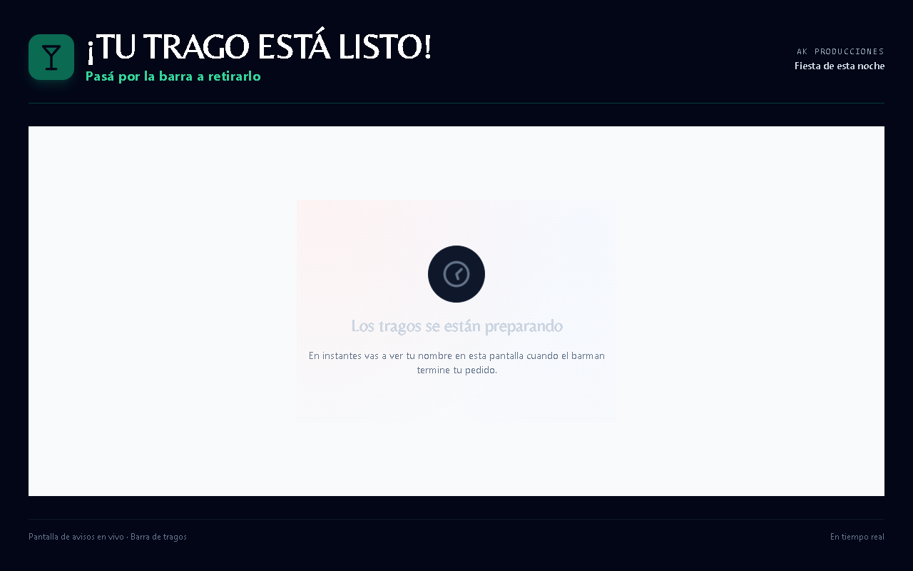

# Barra: estado vacio visible, contraste insuficiente

Fuente ejecutada3e45a4ac6b479f89605163168e31b37dc84f2d0f, build291.
33801 abrio/evento/barra/fiesta_esta_noche/listo con permiso ficticio firmado.
Su cuerpo muestraFiesta de esta noche,Los tragos se estan preparando y la
explicacion del aviso por nombre. CapturaCDP real, revisada porCodex.

El NO_PROBADA del instrumento no demuestra que estuviera vacia:main tiene
texto y la captura lo muestra. La presencia de animacion/espera hace que el
criterio generico de disponibilidad no la acepte; se conserva ese resultado.
No se cambio aPASS automatico ni se probo la entrega de un trago real.

SI hay una observacion visual concreta:main.flex-1 recibe#f8fafc del CSSglobal
importado porRootLayout y elh2 declara slate300,#cbd5e1, muy claro sobre claro.
Contraste de la paleta declarada aproximadamente1.42:1, no medicion de estilos
computados. La captura sustenta el defecto observado de legibilidad.
El icono/recuadro central y la tipografia de respaldo no se usan para afirmar
que el servidor, la sincronizacion o la marca publicada esten rotos.

PR1353 cambio de cabeza:b91 era historica; ahora3f9460185143ef034dcd713e975d2a0af5e20f1a.
Fetch de su ref publicado, diff de los tres archivos relevantes3e/3f vacio.
Correccion NO presente en esos consumidores de la tanda publica; privados
NO CONTRASTADOS. Ver orden220/Gemini, no duplicar si existe trabajo privado.

La captura original esta en la copiaQA/test-results/recorrido y se transporta
comoPNG plana para que pueda revisarse sin archivos de navegador enormes.
Fuentes y lecturas exactas:ak-global-premium.css39-42;RootLayout importa4;
PantallaTragoListoPage11,main83,h2 90-93. Verificar lineas al cambiarSHA.
